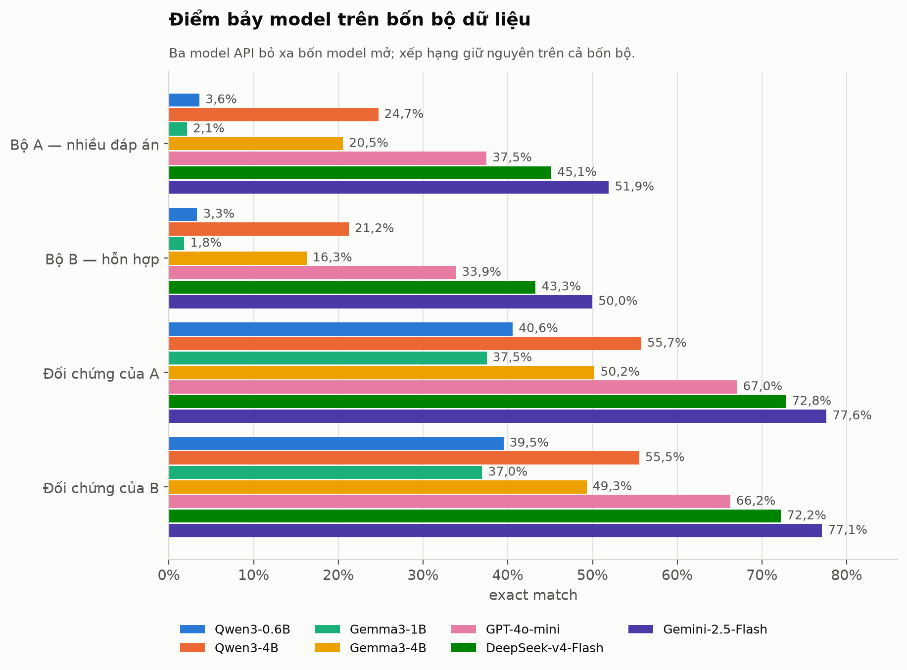
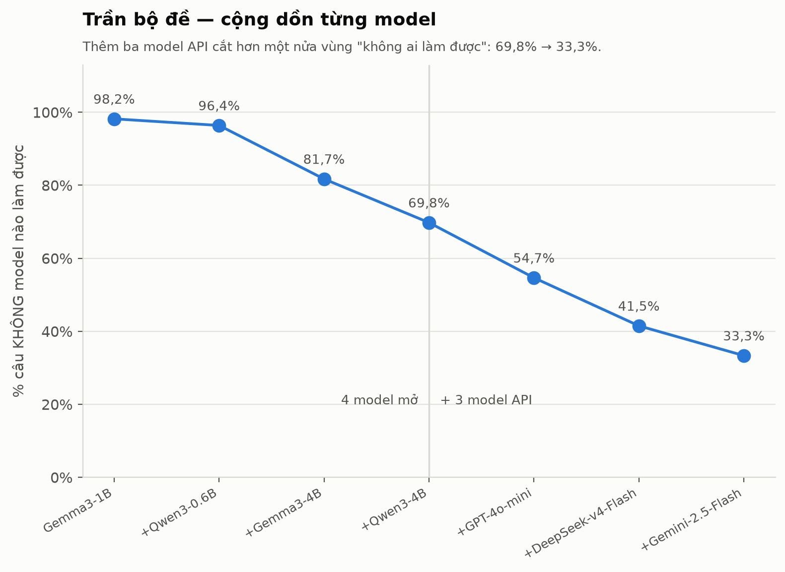
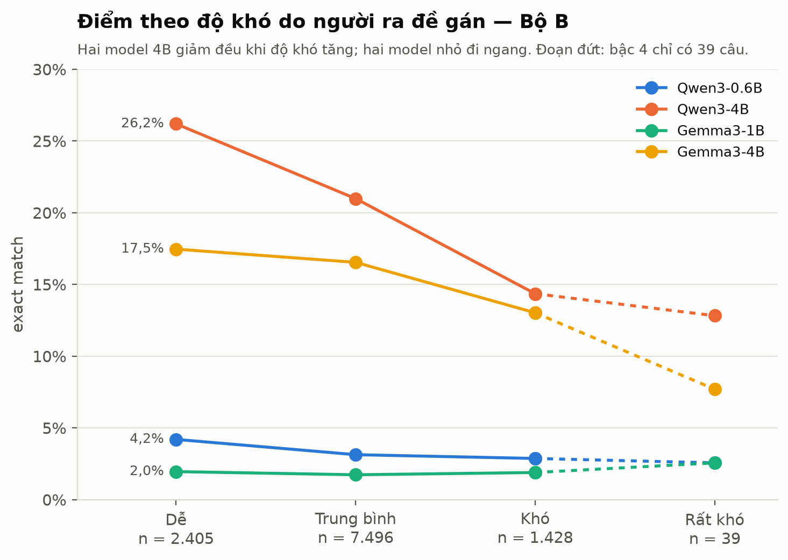
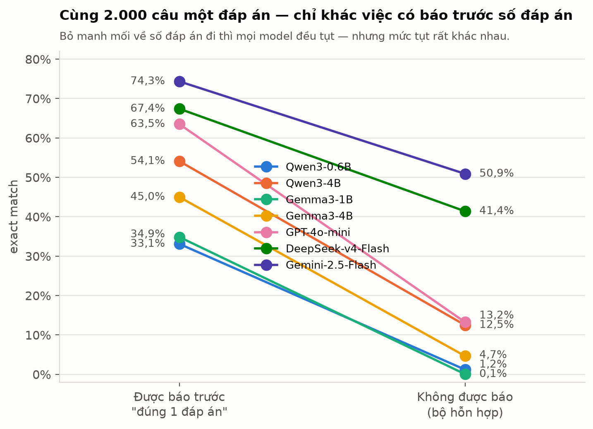
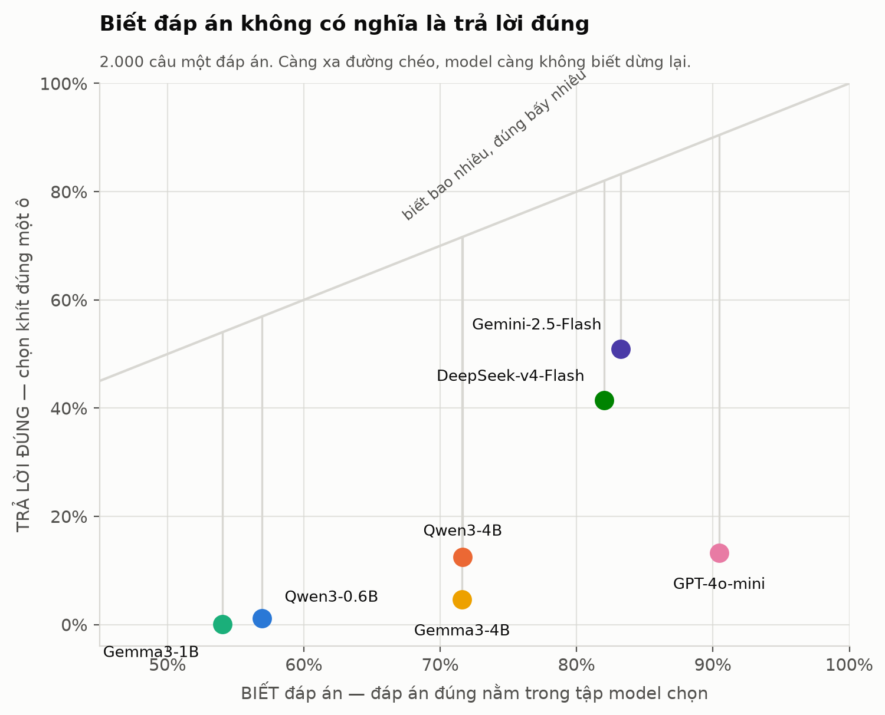
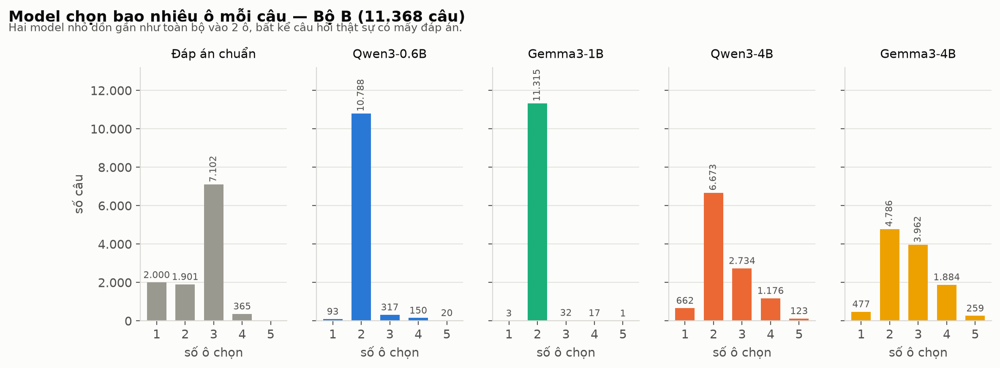

# Chấm 7 model trên benchmark v2

Bốn model mở chạy cục bộ trên GPU, ba model API chạy qua OpenRouter — trên **cùng bốn
bộ dữ liệu**, cùng điều kiện. Cách dựng bộ đề nằm ở [REPORT_V2.md](REPORT_V2.md).

| | |
|---|---|
| Model mở | `Qwen3-0.6B` · `Qwen3-4B` · `Gemma3-1B` · `Gemma3-4B` (vLLM, 1×A10) |
| Model API | `gemini-2.5-flash` · `deepseek-v4-flash-0731` · `gpt-4o-mini` (OpenRouter) |
| Bộ dữ liệu | Bộ A 9.368 · Bộ B 11.368 · hai bản đối chứng một đáp án |
| Tổng lượt gọi | 4 model mở × 41.472 + 3 model API × 41.472 = **290.304** |
| Chi phí API | $4,93 |
| Kết quả thô | [results_v2/](results_v2/) |

**Điều kiện đồng nhất cho cả 7 model**: đầu ra bị ép bằng JSON Schema với enum đúng các
chữ cái của từng câu (grammar-constrained decoding ở vLLM, `structured_outputs` ở API),
`temperature = 0`, và **reasoning tắt hoàn toàn** — script đo `reasoning_tokens` thực tế
và xác nhận bằng 0 ở cả ba model API.

> **Hai model bị loại vì lý do kỹ thuật.** `gpt-5-mini` và `gemini-2.5-pro` trả
> `HTTP 400: "Reasoning is mandatory for this endpoint and cannot be disabled."` Dòng
> suy luận thế hệ mới không cho tắt reasoning, nên không đặt được vào cùng điều kiện với
> các model còn lại. `grok-4.3` chạy được nhưng bị loại vì chi phí: nó tokenize tiếng
> Việt ở mức **1,09 ký tự/token** — gần một token mỗi ký tự, gấp 2,9 lần Gemini — khiến
> chi phí thật là $20,89 thay vì $11,47 như bảng giá gợi ý.

---

## 1. Bảng điểm



| Model | Bộ A | Bộ B | Đối chứng A | Đối chứng B |
|---|---:|---:|---:|---:|
| Gemma3-1B | 2,1% | 1,8% | 37,5% | 37,0% |
| Qwen3-0.6B | 3,6% | 3,3% | 40,6% | 39,5% |
| Gemma3-4B | 20,5% | 16,3% | 50,2% | 49,3% |
| Qwen3-4B | 24,7% | 21,2% | 55,7% | 55,5% |
| GPT-4o-mini | 37,5% | 33,9% | 67,0% | 66,2% |
| DeepSeek-v4-Flash | 45,1% | 43,3% | 72,8% | 72,2% |
| **Gemini-2.5-Flash** | **51,9%** | **50,0%** | **77,6%** | **77,1%** |

Xếp hạng **giống hệt nhau trên cả bốn bộ** — không bộ nào đảo thứ tự, nên kết luận không
phụ thuộc vào việc chọn bộ nào để báo cáo.

Ba model API bỏ xa bốn model mở. Khoảng cách giữa model tốt nhất và tệ nhất trên Bộ B là
**28 lần** (50,0% so với 1,8%).

---

## 2. Bộ đề còn dư địa tới đâu

Đây là câu hỏi lớn nhất còn treo từ lần chấm trước: 69,8% số câu **cả bốn model mở đều
sai** — do câu quá khó, hay do đáp án chuẩn của đề nguồn sai?

Ba model API trả lời được:



| | Số câu Bộ B không model nào làm được | Tỉ lệ |
|---|---:|---:|
| Chỉ 4 model mở | 7.932 | 69,8% |
| **Cả 7 model** | **3.791** | **33,3%** |

Thêm ba model API **cắt hơn một nửa** vùng "không ai làm được". Nghĩa là phần lớn số câu
trước đây trông như hỏng thực ra chỉ nằm ngoài tầm của model nhỏ.

33,3% còn lại là trần hiện tại. Nó gồm hai thành phần chưa tách được: câu thật sự khó,
và câu có đáp án chuẩn sai do kế thừa từ đề nguồn (mục 9 của [REPORT_V2.md](REPORT_V2.md)
có ví dụ insulin tác dụng ngắn ghi "kéo dài 24 giờ"). Muốn tách thì cần model mạnh hơn
nữa, hoặc thẩm định tay một mẫu.

---

## 3. Theo độ khó



Trường `difficultLevel` của đề gốc có 15 cách viết khác nhau (`'2'`, `'Level 2'`,
`'Level 2 (Moderate)'`, `'Medium'`…) nên phải quy về một thang chung trước khi đếm.

**Số câu đúng / sai — Bộ B (11.368 câu)**

| Độ khó | n | Qwen3-0.6B | Gemma3-1B | Gemma3-4B | Qwen3-4B | GPT-4o-mini | DeepSeek | Gemini |
|---|---:|---:|---:|---:|---:|---:|---:|---:|
| 1 — Dễ | 2.405 | 101 / 2.304 | 47 / 2.358 | 420 / 1.985 | 630 / 1.775 | 856 / 1.549 | 1.197 / 1.208 | 1.370 / 1.035 |
| 2 — Trung bình | 7.496 | 235 / 7.261 | 130 / 7.366 | 1.240 / 6.256 | 1.573 / 5.923 | 2.594 / 4.902 | 3.217 / 4.279 | 3.717 / 3.779 |
| 3 — Khó | 1.428 | 41 / 1.387 | 27 / 1.401 | 186 / 1.242 | 205 / 1.223 | 395 / 1.033 | 496 / 932 | 585 / 843 |
| 4 — Rất khó | 39 | 1 / 38 | 1 / 38 | 3 / 36 | 5 / 34 | 5 / 34 | 10 / 29 | 9 / 30 |

**Cùng số liệu, theo tỉ lệ**

| Độ khó | n | % bộ | Qwen3-0.6B | Gemma3-1B | Gemma3-4B | Qwen3-4B | GPT-4o-mini | DeepSeek | Gemini |
|---|---:|---:|---:|---:|---:|---:|---:|---:|---:|
| 1 — Dễ | 2.405 | 21,2% | 4,2% | 2,0% | 17,5% | 26,2% | 35,6% | 49,8% | **57,0%** |
| 2 — Trung bình | 7.496 | 65,9% | 3,1% | 1,7% | 16,5% | 21,0% | 34,6% | 42,9% | 49,6% |
| 3 — Khó | 1.428 | 12,6% | 2,9% | 1,9% | 13,0% | 14,4% | 27,7% | 34,7% | 41,0% |
| 4 — Rất khó | 39 | 0,3% | 2,6% | 2,6% | 7,7% | 12,8% | 12,8% | 25,6% | 23,1% |

**Nhãn độ khó của đề gốc là thật, và bằng chứng giờ mạnh hơn hẳn.** Cả **năm** model đủ
mạnh đều giảm đơn điệu khi độ khó tăng — Gemini 57,0% → 49,6% → 41,0%, DeepSeek 49,8% →
42,9% → 34,7%, GPT-4o-mini 35,6% → 34,6% → 27,7%. Đây là phép kiểm tra tính hợp lệ độc
lập: nhãn do người ra đề gán, pipeline dựng benchmark không hề dùng tới nó, vậy mà nó dự
báo được điểm của mọi model đủ năng lực.

Hai model nhỏ nhất **không** cho tín hiệu đó (4,2% → 3,1% → 2,9% và 2,0% → 1,7% → 1,9%).
Chúng hỏng ở định dạng chứ không phải ở kiến thức, nên độ khó nội dung không còn ảnh hưởng.

Bậc 4 chỉ có 39 câu (0,3%) nên chênh một câu là đổi 2,6 điểm — không đọc dòng đó như một
xu hướng. Biểu đồ vẽ nét đứt ở đoạn này.

---

## 4. Theo họ câu hỏi — Bộ B

| Họ | n | Qwen3-0.6B | Gemma3-1B | Gemma3-4B | Qwen3-4B | GPT-4o-mini | DeepSeek | Gemini |
|---|---:|---:|---:|---:|---:|---:|---:|---:|
| file1_ngoai_tru | 4.573 | 1,3% | 0,2% | 20,8% | 20,2% | 41,0% | 43,5% | **49,7%** |
| file2_them_nhieu | 1.092 | 2,3% | 0,0% | 28,4% | 38,7% | 60,4% | 60,7% | **67,2%** |
| file3_tach_dau_phay | 2.810 | 5,8% | 5,1% | 9,5% | 16,9% | 22,0% | 33,4% | **39,9%** |
| file4_ca_ab | 893 | 11,9% | 6,0% | 25,5% | 38,2% | 48,2% | 56,3% | **60,1%** |
| single_1_dap_an | 2.000 | 1,2% | 0,1% | 4,7% | 12,5% | 13,2% | 41,4% | **50,9%** |

`file3_tach_dau_phay` khó nhất với mọi model — đây là họ mà phương án được tách ra từ
danh sách ngăn bởi dấu phẩy, đòi hỏi chọn đúng một tập con từ 4–5 mục độc lập.

`single_1_dap_an` cho khoảng cách lớn nhất giữa các model: từ 0,1% (Gemma3-1B) tới 50,9%
(Gemini) — gấp **509 lần**. Lý do ở mục sau.

---

## 5. Phát hiện chính: biết đáp án ≠ biết chọn mấy ô



Trên **cùng 2.000 câu một đáp án**, chỉ khác ở chỗ model có được báo trước số đáp án hay không:

| Model | Được báo "đúng 1 đáp án" | Không được báo | Chênh | Chỉ chọn 1 ô | Đáp án đúng ⊆ tập chọn |
|---|---:|---:|---:|---:|---:|
| Qwen3-0.6B | 33,1% | 1,2% | −31,9 | 1,9% | 56,9% |
| Gemma3-1B | 34,8% | 0,1% | −34,8 | 0,1% | 54,0% |
| Gemma3-4B | 45,0% | 4,7% | −40,4 | 7,4% | 71,6% |
| Qwen3-4B | 54,1% | 12,5% | −41,6 | 16,6% | 71,7% |
| **GPT-4o-mini** | 63,5% | 13,2% | **−50,2** | 15,0% | **90,5%** |
| DeepSeek-v4-Flash | 67,4% | 41,4% | −26,0 | 52,1% | 82,0% |
| Gemini-2.5-Flash | **74,4%** | **50,9%** | **−23,5** | **63,2%** | 83,2% |

**GPT-4o-mini là ví dụ rõ nhất của việc benchmark này đo cái gì.** Nó biết đáp án ở
**90,5% số câu** — cao nhất trong cả bảy model, hơn cả Gemini. Nhưng nó chỉ chọn đúng một
ô ở 15,0% số câu, nên điểm rơi từ 63,5% xuống 13,2%, mức tụt lớn nhất bảng.

Kiến thức của nó tốt hơn Gemini. Khả năng **dừng lại đúng lúc** thì kém hơn bốn lần.



Trục ngang là **biết** (đáp án đúng nằm trong tập model chọn), trục dọc là **trả lời
đúng** (chọn khít đúng một ô). Model nằm trên đường chéo thì chuyển hoá được toàn bộ
kiến thức thành câu trả lời đúng; khoảng cách xuống dưới đường chéo chính là phần mất đi
vì không biết dừng. GPT-4o-mini nằm xa nhất về bên phải nhưng gần đáy — biết nhiều nhất,
chuyển hoá kém nhất.

Đây chính xác là thứ Bộ B được dựng để đo, và là thứ định dạng một đáp án truyền thống
không thể phát hiện.

---

## 6. Hiệu chỉnh số lượng ô



Đáp án chuẩn trung bình 2,51 ô mỗi câu.

| Model | TB số ô | Khớp số ô | 1 ô | 2 ô | 3 ô | 4 ô | 5 ô |
|---|---:|---:|---:|---:|---:|---:|---:|
| *Đáp án chuẩn* | *2,51* | — | *2.000* | *1.901* | *7.102* | *365* | *0* |
| Gemma3-1B | 2,01 | 16,8% | 3 | **11.315** | 32 | 17 | 1 |
| Qwen3-0.6B | 2,05 | 19,0% | 93 | **10.788** | 317 | 150 | 20 |
| Qwen3-4B | 2,42 | 36,3% | 662 | 6.673 | 2.734 | 1.176 | 123 |
| Gemma3-4B | 2,71 | 35,5% | 477 | 4.786 | 3.962 | 1.884 | 259 |
| GPT-4o-mini | **3,06** | 45,9% | 375 | 2.259 | 5.469 | 2.801 | 464 |
| DeepSeek-v4-Flash | 2,63 | 54,1% | 1.426 | 3.656 | 4.265 | 1.715 | 305 |
| **Gemini-2.5-Flash** | **2,48** | **61,1%** | 1.845 | 3.469 | 4.865 | 1.057 | 128 |

Ba kiểu hỏng khác nhau:

- **Hai model nhỏ nhất mù hoàn toàn về số lượng.** Gemma3-1B chọn đúng 2 ô ở 11.315/11.368
  câu (99,5%). Chúng bỏ qua nội dung câu hỏi khi quyết định chọn mấy ô.
- **GPT-4o-mini chọn thừa** — trung bình 3,06 ô so với chuẩn 2,51. Nó gom cả những ô
  không chắc, nên đáp án đúng gần như luôn nằm trong tập chọn (90,5%) mà hiếm khi trùng khít.
- **Gemini hiệu chỉnh tốt nhất** — 2,48 ô so với chuẩn 2,51, khớp đúng số ô ở 61,1% số câu,
  gấp gần bốn lần hai model nhỏ.

Thứ tự theo "khớp số ô" gần trùng với thứ tự theo điểm tổng, nhưng không hoàn toàn:
Gemma3-4B chọn thừa (2,71) trong khi Qwen3-4B chọn thiếu (2,42), lệch ngược chiều với độ
lớn tương đương — mà Qwen3-4B vẫn hơn 5 điểm.

---

## 7. Kết luận

**Về các model.** Gemini-2.5-Flash dẫn đầu ở mọi bộ, mọi họ câu hỏi, mọi bậc độ khó.
Ba model API đều gấp 1,6–2,4 lần model mở tốt nhất (Qwen3-4B). Ở cỡ nhỏ, Qwen3-0.6B nhỉnh
hơn Gemma3-1B nhưng cả hai đều không dùng được ở định dạng nhiều đáp án.

**Về bộ đề.** Nó phân biệt được trên một dải năng lực rất rộng — từ 1,8% tới 50,0% — và
chưa bão hoà: model tốt nhất mới đúng một nửa. Nhãn độ khó của đề nguồn tương quan chặt
với điểm của mọi model đủ mạnh, một dấu hiệu tính hợp lệ độc lập với cách dựng.

**Còn lại 33,3% số câu chưa model nào làm được.** Đó là giới hạn hiện tại của bộ đề. Bước
tiếp theo đáng làm nhất là lấy mẫu vài trăm câu trong nhóm đó và thẩm định tay, để biết
bao nhiêu phần là câu khó thật và bao nhiêu là đáp án chuẩn sai kế thừa từ đề nguồn.

---

## Phụ lục — tái tạo

```bash
# 4 model mở, trên máy có GPU
bash lambda/eval_v2.sh all
MODELS="1b|unsloth/gemma-3-1b-it 4b|unsloth/gemma-3-4b-it" PREFIX=gemma bash lambda/eval_v2.sh all
```
```powershell
# 3 model API — cần OPENROUTER_API_KEY trong .env
foreach ($m in @("google/gemini-2.5-flash","openai/gpt-4o-mini","deepseek/deepseek-v4-flash-0731")) {
  foreach ($d in @("mixed","multi","mixedsingle","single")) {
    python eval_openrouter.py --model $m --dataset $d --concurrency 24
  }
}
python analyze_results.py --data processed_data_v2/final_benchmark_mixed.json `
                          --prov processed_data_v2/final_benchmark_mixed_provenance.json `
                          --result "Gemini-2.5-Flash=results_v2/eval_mixed_gemini-25-flash.json"
python make_figures.py
```

Biểu đồ do [make_figures.py](make_figures.py) sinh, đọc số liệu thẳng từ
`processed_data_v2/` và `results_v2/` — không nhập tay con số nào, nên hình và bảng trong
tài liệu này không thể lệch nhau.
